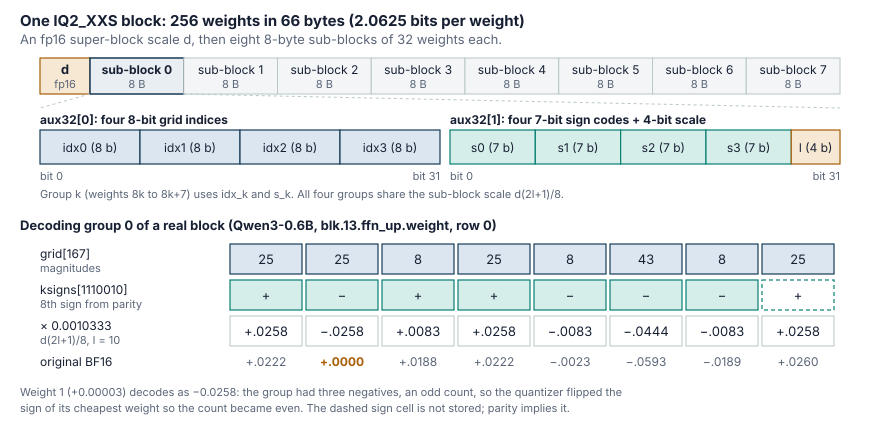

*A standalone note on GGUF weight formats. For the general ideas behind codes,
scales and rounding error, see
[chapter 13 of the tinyserve book]().*

llama.cpp can store a model weight in about two bits. IQ2_XXS, the smallest
of its 2-bit types, packs 256 weights into 66 bytes: 2.0625 bits per weight.
At that budget a weight cannot afford its own code, so how does the format
fit 256 weights into 66 bytes, and how does the quantizer decide which bits
to write?

This post answers both questions with a real file. I quantized Qwen3-0.6B to
IQ2_XXS with llama.cpp and took one block apart byte by byte. Then I followed
the quantizer that wrote that block, one step at a time. I ported both
directions to Python ([scripts](#reproduce-it)) and checked them against
llama.cpp:

- The decoder matches gguf-py's reference dequantizer bit for bit on every
  IQ2 tensor in three quantized models.
- The encoder reproduces `llama-quantize`'s output on 6,397 of 6,400 blocks
  across six tensors. The other three differ only because Python computes in
  float64, where ggml uses float32.

Writing the port also turned up a small quirk in the C quantizer, covered in
[its own section](#the-port-and-a-quirk-it-had-to-copy).

| Part | Question |
|---|---|
| [GGUF in one screen](#gguf-in-one-screen) | Where do a tensor's bytes live in the file? |
| [The block](#the-iq2_xxs-block) | What are the 66 bytes? |
| [Dequantization](#dequantization) | How do 66 bytes become 256 floats? |
| [Quantization](#quantization) | How does the quantizer choose those bytes? |
| [IQ2_XS and IQ2_S](#iq2_xs-and-iq2_s-same-idea-more-bits) | What do the larger 2-bit types change? |
| [A loose end](#a-loose-end-the-decoder-does-not-use-135) | Why does the decoder use 8, 25, 43? |

All line references point at llama.cpp commit
[`d7bd3bf`](https://github.com/ggml-org/llama.cpp/tree/d7bd3bfcad3e29c7e49fd26f38c79ee3e9a3fd6b)
(August 2026).

## GGUF in one screen

"GGML format" usually means two layers. The **GGUF container** is the file:
metadata plus a table of tensors. Each tensor's bytes are encoded in a
**ggml type** such as BF16, Q4_K or IQ2_XXS. The container is simple enough
to parse with a page of Python using only `struct`
([`gguf_walk.py`](/assets/iq2/gguf_walk.py)):

```text
"GGUF" | version u32 (=3) | n_tensors i64 | n_kv i64
KV pairs     : key (u64 length + UTF-8) | value type u32 | value
               (an array is: element type u32 | count u64 | elements)
tensor infos : name | n_dims u32 | ne[n_dims] i64 | ggml type u32 | offset u64
padding to general.alignment (default 32)
data blob    : each tensor's bytes start at data_start + offset
```

Everything is little-endian, and strings carry a length instead of a NUL
terminator. In `Qwen3-0.6B-BF16.gguf` the header holds 37 metadata keys and 311
tensor infos and ends at byte 5,951,738. The data blob starts at the next
multiple of 32, byte 5,951,744. The offsets account for every byte: the data
start plus the last tensor's offset and size equals the file size,
1,509,347,584.

Three details trip people up:

- **`ne[0]` is the contiguous dimension**, so the order is the reverse of
  PyTorch's. An `ffn_up` weight of PyTorch shape `[3072, 1024]` appears as
  `ne = [1024, 3072]`: 3,072 rows of 1,024 weights.
- **Everything except the weights lives in metadata**, including hyperparameters
  (`qwen3.block_count = 28`), the whole tokenizer (151,936 tokens and their
  merges), and the chat template. Even the importance matrix used below is
  stored as a GGUF file.
- **Quantized tensors have no per-tensor scale or padding.** A row of `ne[0]`
  weights is `ne[0] / 256` consecutive blocks, and every scale lives inside a
  block.

### A file type is a recipe, not a tensor type

`llama-quantize ... IQ2_XXS` writes `general.file_type = 19` ("mostly
IQ2_XXS"), but the file is not all IQ2_XXS. The recipe in
[`src/llama-quant.cpp`](https://github.com/ggml-org/llama.cpp/blob/d7bd3bfcad3e29c7e49fd26f38c79ee3e9a3fd6b/src/llama-quant.cpp#L491-L531)
keeps sensitive tensors at higher precision:

| Tensors | Type in the "IQ2_XXS" file | Size |
|---|---|---|
| `output.weight` | Q5_K | 102.0 MiB |
| `token_embd`, all 28 `attn_v`, the first 3 `ffn_down` | Q2_K (32 tensors) | 60.8 MiB |
| every other 2-D weight | IQ2_XXS (165 tensors) | 98.7 MiB |
| norms (1-D) | F32 (113 tensors) | 0.2 MiB |

The file averages 2.92 bits per weight, not 2.06, mostly because of the output
projection. (`attn_v` falls back to Q2_K because Qwen3-0.6B's GQA ratio is
16/8 = 2; at 4 or more the recipe uses Q4_K.)

A related trap: the **IQ2_S file type contains no IQ2_S tensors**. Its default
tensor type is IQ2_XS; the file type that uses IQ2_S tensors is IQ2_M
([`llama-quant.cpp:859-860`](https://github.com/ggml-org/llama.cpp/blob/d7bd3bfcad3e29c7e49fd26f38c79ee3e9a3fd6b/src/llama-quant.cpp#L859-L860)).

## The IQ2_XXS block

The block is defined in
[`ggml-common.h`](https://github.com/ggml-org/llama.cpp/blob/d7bd3bfcad3e29c7e49fd26f38c79ee3e9a3fd6b/ggml/src/ggml-common.h#L378-L385):

```c
// (Almost) "true" 2-bit quantization.
// Due to the need to use blocks as per ggml design, it ends up using
// 2.0625 bpw because of the 16-bit scale for each block of 256.
typedef struct {
    ggml_half d;
    uint16_t qs[QK_K/8];   // QK_K = 256, so 32 x uint16 = 64 bytes
} block_iq2_xxs;
```

The type declares `qs` as 32 `uint16` values, but every reader treats it as 8
sub-blocks of two `uint32` words. The 256 weights split three ways: 8
sub-blocks of 32, each made of 4 groups of 8.



Each group of 8 weights gets one 8-bit index into a table of 256 magnitude
patterns and one 7-bit sign code. Each sub-block of 32 gets a 4-bit scale, and
the whole block gets one fp16 scale:

| Field | Bits | Covers | Bits per weight |
|---|---|---|---|
| grid index | 8 | 8 weights | 1.0 |
| sign code | 7 | 8 weights | 0.875 |
| sub-block scale `l` | 4 | 32 weights | 0.125 |
| super-block scale `d` (fp16) | 16 | 256 weights | 0.0625 |
| **total** | | | **2.0625** |

The format works because it never quantizes a weight on its own. It quantizes
**vectors of 8 weights**, choosing among a fixed set of allowed shapes.

## Dequantization

Weight $j$ of group $k$ in sub-block $b$ decodes as

$$
\hat{x}_{32b+8k+j} \;=\; \underbrace{d\cdot\frac{2l_b+1}{8}}_{\text{sub-block scale}}\;\cdot\; g_{\,\mathrm{idx}_{b,k}}[j] \;\cdot\; \sigma_{b,k}[j]
$$

where $g$ is a row of the 256-entry magnitude table and
$\sigma \in \lbrace -1, +1 \rbrace^8$ comes from the sign code. The C code in
[`ggml-quants.c`](https://github.com/ggml-org/llama.cpp/blob/d7bd3bfcad3e29c7e49fd26f38c79ee3e9a3fd6b/ggml/src/ggml-quants.c#L2488-L2512)
is short (comments mine):

```c
for (int ib32 = 0; ib32 < QK_K/32; ++ib32) {                  // 8 sub-blocks
    memcpy(aux32, x[i].qs + 4*ib32, 2*sizeof(uint32_t));
    const float db = d * (0.5f + (aux32[1] >> 28)) * 0.25f;   // = d (2l+1) / 8
    for (int l = 0; l < 4; ++l) {                             // 4 groups of 8
        const uint8_t * grid = (const uint8_t *)(iq2xxs_grid + aux8[l]);
        const uint8_t  signs = ksigns_iq2xs[(aux32[1] >> 7*l) & 127];
        for (int j = 0; j < 8; ++j) {
            y[j] = db * grid[j] * (signs & kmask_iq2xs[j] ? -1.f : 1.f);
        }
        y += 8;
    }
}
```

Three lookup tables do the work.

**`iq2xxs_grid`: 256 magnitude patterns.** Each entry is a `uint64` holding 8
bytes, and every byte is `0x08`, `0x19` or `0x2b`, that is 8, 25 or 43. Three
levels in 8 positions allow $3^8 = 6561$ patterns, and the table keeps 256 of
them. Those 256 are not arbitrary. Mapped to the quantizer's levels
$q \in \lbrace 1, 3, 5\rbrace$ (more on those below), every pattern is a point
of the E8 lattice: $q/2$ has half-integer coordinates whose sum is even. That
is the lattice QuIP# builds its 2-bit codebook from. I checked all 256 entries
here, and all 512 and 1024 entries of the larger IQ2 grids. Note that **there
is no zero level**: every weight decodes to at least one unit,
$\pm d(2l+1)/8$.

**`ksigns_iq2xs`: 8 signs from 7 bits.** The sign code stores the signs of
the first 7 weights. The 8th sign is whatever makes the number of minus signs
even, so `ksigns_iq2xs[s] = s | (popcount(s) & 1) << 7`, which holds for all
128 entries. For example, `ksigns_iq2xs[1] = 129`: one minus sign stored
implies a second one on weight 7. This saves 1 bit per 8 weights (0.125 bits
per weight), but it constrains the encoder, as we will see.

**`kmask_iq2xs`** is just `1 << j`.

### One real block

Here is the first block of row 0 of `blk.13.ffn_up.weight` in the IQ2_XXS
file, decoded by hand
([`iq2_decode.py`](/assets/iq2/iq2_decode.py) prints this):

```text
raw block (66 B): 730e | a7172b0cf27e28a2 | 470001609467399c74457b3c...
  d (fp16 super-block scale) = 0.000393629
  sub-block 0: aux32[0]=0x0c2b17a7  aux32[1]=0xa2287ef2
     aux32[1] bits = 1010 | 0010001 0100001 1111101 1110010   (scale | signs g3 g2 g1 g0)
     4-bit scale l=10 -> db = d*(0.5+l)/4 = 0.00103328
     group 0: grid idx 167 -> [25, 25, 8, 25, 8, 43, 8, 25]  signs7=1110010 -> ksigns=01110010
              decoded : +0.0258 -0.0258 +0.0083 +0.0258 -0.0083 -0.0444 -0.0083 +0.0258
              original: +0.0222 +0.0000 +0.0188 +0.0222 -0.0023 -0.0593 -0.0189 +0.0260
     group 1: grid idx  23 -> [8, 8, 25, 8, 25, 8, 8, 8]  signs7=1111101 -> ksigns=01111101
              decoded : -0.0083 +0.0083 -0.0258 -0.0083 -0.0258 -0.0083 -0.0083 +0.0083
              original: -0.0085 +0.0187 -0.0229 -0.0124 -0.0222 +0.0016 -0.0178 +0.0001
```

The bytes read little-endian: `730e` is the fp16 value `0x0e73`, and the four
bytes `a7 17 2b 0c` are the grid indices 167, 23, 43 and 12 for groups 0 to 3.
With only three magnitudes per sub-block (8, 25 and 43 units, here 0.0083,
0.0258 and 0.0444), the decoded values are coarse. Most land close to the
original, but look at weight 1 of group 0: its original value is +0.00003, and
it decodes as **−0.0258**. That is the parity constraint at work, and the
quantizer section explains why it is the cheapest weight to get wrong.

The numpy version of the decoder handles all blocks at once:

```python
def sign_bytes_to_pm1(sb):                               # (..., ) uint8 -> (..., 8) of +-1
    return np.where((sb[..., None] >> BITS) & 1, -1.0, 1.0).astype(np.float32)


def deq_iq2_xxs(blk):                                    # blk: (nb, 66) uint8
    nb = blk.shape[0]
    d = blk[:, :2].copy().view(np.float16).astype(np.float32)          # (nb,1)
    q = blk[:, 2:].copy().view(np.uint32).reshape(nb, 8, 2)            # 8 sub-blocks x (aux32[0], aux32[1])
    db = d * (0.5 + (q[..., 1] >> 28)) * 0.25                          # (nb,8)  4-bit scale in top nibble
    idx = q[..., 0:1].view(np.uint8).reshape(nb, 8, 4)                 # 4 x 8-bit grid indices
    s7 = (q[..., 1:2] >> np.array([0, 7, 14, 21], dtype=np.uint32)) & 127   # 4 x 7-bit sign codes
    signs = sign_bytes_to_pm1(KSIGNS[s7])                              # parity restores the 8th sign
    return (db[..., None, None] * GRID["IQ2_XXS"][idx] * signs).reshape(nb, 256)
```

### Inference does not build float weights

The function above is what gguf-py uses, but llama.cpp's matrix-vector
product never materializes floats. On CPU, the activation vector is first
quantized to Q8_K (int8 values with one float scale per 256), and the
[dot-product kernel](https://github.com/ggml-org/llama.cpp/blob/d7bd3bfcad3e29c7e49fd26f38c79ee3e9a3fd6b/ggml/src/ggml-cpu/quants.c#L906-L946)
works in integers inside each block (excerpt, comments mine):

```c
const uint32_t ls = 2*(aux32[1] >> 28) + 1;                    // integer sub-block scale
...
        sumi += grid[j] * q8[j] * (signs & kmask_iq2xs[j] ? -1 : 1);
...
    bsum += sumi * ls;                                         // still integer
}
sumf += d * bsum;                                              // d = d_weight * d_activation
...
*s = 0.125f * sumf;
```

In formula form, with $a_i$ the int8 activations and $d_a$ their scale:

$$
\mathbf{w}\cdot\mathbf{a} \;\approx\; \frac{d\, d_a}{8}\sum_{b=0}^{7} (2l_b+1)\sum_{i\in b} g_i\,\sigma_i\,a_i
$$

This is why the format looks the way it does. The magnitudes are small
integers, the sub-block scale is the odd integer $2l+1$, and the common
factor $1/8$ is pulled out. Everything inside a block is integer
multiply-add, with one float multiply per 256 weights.

## Quantization

Decoding is a table lookup. Encoding is a search: for every sub-block of 32
weights, the quantizer has to pick 4 grid points, the signs, and a scale. The
code is `quantize_row_iq2_xxs_impl` in
[`ggml-quants.c`](https://github.com/ggml-org/llama.cpp/blob/d7bd3bfcad3e29c7e49fd26f38c79ee3e9a3fd6b/ggml/src/ggml-quants.c#L3294-L3470).
Here is the whole procedure in one list; the subsections take it step by step.

1. Weight each element by its **importance** (activation statistics times magnitude).
2. Split off the **signs**. If a group of 8 has an odd number of negatives,
   flip the cheapest one.
3. **Search for a scale**: try 13 candidates, round the magnitudes to levels,
   snap each group of 8 onto the grid, and keep the candidate with the lowest
   weighted error.
4. Snap once more at the winning scale and refit the scale by least squares.
5. After all 8 sub-blocks, encode the 8 scales as one fp16 `d` and eight 4-bit `l`.

### The tables the quantizer builds

The quantizer does not work in 8/25/43 units. It works in **levels**
$l \in \lbrace 0, 1, 2\rbrace$ with values $q = 2l+1 \in \lbrace 1, 3, 5\rbrace$
([`ggml-quants.c:3124`](https://github.com/ggml-org/llama.cpp/blob/d7bd3bfcad3e29c7e49fd26f38c79ee3e9a3fd6b/ggml/src/ggml-quants.c#L3119-L3126)).
That is the same grid in the same order, scaled differently;
[a later section](#a-loose-end-the-decoder-does-not-use-135) looks at the
mismatch. A group of 8 levels packs into a 16-bit code, 2 bits per weight.

`iq2xs_init_impl` builds two lookup structures over all $3^8 = 6561$
level patterns:

- a **map** from each of the 256 on-grid patterns to its grid index;
- a **neighbor list** for each of the 6,305 off-grid patterns. The list holds
  every grid point in the two nearest distance shells, measured in level space.
  Lists range from 2 to 150 points, 17.9 on average.

Rounding 8 magnitudes usually produces an off-grid pattern, so the neighbor
lists are what make the search affordable: the quantizer scores a short list
(18 points on average) instead of all 256.

### Step 1: importance weights

The goal is not to reproduce the weights; it is to reproduce the layer's
**output**. For a linear layer $y = Wa$, a weight error $\Delta W$ changes
output $r$ by $(\Delta W a)_r$. Its expected square is

$$
\mathbb{E}\big[(\Delta W a)_r^2\big] \;=\; \sum_{j,k} \Delta W_{rj}\,\Delta W_{rk}\,\mathbb{E}[a_j a_k]
\;\approx\; \sum_j \Delta W_{rj}^2\;\mathbb{E}[a_j^2]
$$

if we drop the off-diagonal terms. So a weight matters in proportion to the
mean square of the activation it multiplies. That is exactly what the
**importance matrix** stores. `llama-imatrix` runs the model on calibration
text and accumulates $\sum a_j^2$ for every input column of every linear
layer (the tensors `*.in_sum2` and `*.counts` in `imatrix.gguf`). The
quantizer divides one by the other to get $\mathbb{E}[a_j^2]$.

IQ2_XXS combines that with the weight's own size:

$$
w_i \;=\; \mathbb{E}[a_i^2]\cdot\sqrt{\sigma^2 + x_i^2}, \qquad \sigma^2 = \tfrac{1}{256}\textstyle\sum_{\text{block}} x^2
$$

The second factor gives large weights more say without letting small ones
drop to zero importance. IQ2_XXS **refuses to run without an imatrix**
(`GGML_ASSERT(quant_weights)` at
[line 3302](https://github.com/ggml-org/llama.cpp/blob/d7bd3bfcad3e29c7e49fd26f38c79ee3e9a3fd6b/ggml/src/ggml-quants.c#L3302)).
At two bits, where the error goes matters as much as how big it is.

For the block above, the importance of input columns 0 to 7 is:

```text
E[a^2], columns 0..7:   3.49   1.61e-09   0.527   112   1.16   5.98   1.38   3.11
```

Column 1 is an almost dead input channel. Whatever happens to weight 1, the
layer's output barely changes.

### Step 2: signs and the parity flip

The quantizer separates each weight into a sign and a magnitude. The 7-bit
code can only express an even number of negatives, so in a group with an odd
count, one weight must be stored with the wrong sign. Its decoded value then
has the wrong sign, and its weighted error is at least $w_i x_i^2$. So the
quantizer flips the weight where $w_i x_i^2$ is smallest. It keeps that entry
as $-\lvert x_i\rvert$ in the magnitude vector, so the scale fit in the next
step sees the cost of the wrong sign.

On the block above
([`trace_quant.py`](/assets/iq2/trace_quant.py) prints this for sub-block 0):

```text
group 0: negatives at [4, 5, 6] odd -> flip w[1] (x=+0.000029, cost w*x^2=3.32e-20) -> stored 7 bits 1110010
group 1: negatives at [0, 2, 3, 4, 6] odd -> flip w[5] (x=+0.001648, cost w*x^2=2.02e-14) -> stored 7 bits 1111101
group 2: negatives at [0, 5]   -> stored 7 bits 0100001
group 3: negatives at [0, 4]   -> stored 7 bits 0010001
```

Group 0 had three negatives, so one weight had to flip. Weight 1 is tiny
**and** sits on the dead input channel, so its cost is $3\times10^{-20}$. That
is why +0.00003 decodes as −0.0258: the error is large in weight space and
nearly free in output space. Across 8,192 groups of this tensor, 49.0%
needed a flip, as you would expect from random signs.

### Step 3: the scale search

Within a sub-block of 32 magnitudes $x_i$, the quantizer wants

$$
\min_{s,\;q}\;\sum_{i=1}^{32} w_i\,(x_i - s\,q_i)^2
\quad\text{where each group of 8 values of } q \text{ is one of the 256 grid points.}
$$

For a fixed choice of $q$ the best scale has a closed form, and so does the
error left over:

$$
s^\star = \frac{\sum_i w_i x_i q_i}{\sum_i w_i q_i^2},\qquad
E(s^\star) = \sum_i w_i x_i^2 \;-\; \frac{\big(\sum_i w_i x_i q_i\big)^2}{\sum_i w_i q_i^2}
$$

The first term does not depend on $q$, so **minimizing the error means
maximizing** $(\sum w x q)^2 / \sum w q^2$. In the code that quantity is
`best`, and `sumqx*sumqx > best*sumq2` is the comparison that keeps a
candidate.

The catch is that $q$ depends on $s$ through rounding. The quantizer handles
that with a small search:

- **Initial guess.** `make_qp_quants` fits $x \approx s_0 L$ with integer
  $L \in [0, 4]$ by weighted least squares. That gives
  $\text{eff\_max} = 3 s_0$.
- **Candidates.** It tries 13 inverse scales
  $\text{id} = (5 + 0.1 i)/\text{eff\_max}$ for $i = -6,\dots,6$, a ±12%
  window around the guess.
- **Round.** Each magnitude goes to the nearest of $\lbrace 1,3,5\rbrace/\text{id}$:
  $l_i = \mathrm{clamp}\big(\mathrm{round}((\text{id}\cdot x_i - 1)/2), 0, 2\big)$.
- **Snap.** If a group's 8 levels form a grid point, take it. Otherwise score
  the pattern's neighbor list and take the closest point under the weighted
  distance $\sum_i \sqrt{w_i} (s q_i - x_i)^2$. (That weight really is
  $\sqrt{w}$ in the code, not $w$.)
- **Score.** Compute $s^\star$ and the score for the snapped points, and keep
  the best candidate.

For sub-block 0 of the block above:

```text
max|x| = 0.05933; make_qp_quants scale = 0.011825 -> eff_max = 0.035474
 is       id      1/id off-grid  LSQ scale      score
 -6   124.03  0.008062        3   0.008249    0.00378  <- best
 -5   126.85  0.007883        2   0.008249    0.00378
 -4   129.67  0.007712        2   0.008187   0.003778
  ...  (is = -3 .. 3 all land on the same points as -4)
  4   152.22  0.006569        3   0.007816   0.003734
  5   155.04  0.006450        3   0.007816   0.003734
  6   157.86  0.006335        3   0.007816   0.003734
```

Two things stand out. At every candidate, two or three of the four groups
round to an off-grid pattern and need the neighbor search, so snapping is the
normal case rather than the exception. And the winner sits at the edge of the
window ($i = -6$): the search cannot see whether a smaller inverse scale would
have been better still.

### Step 4: final snap and refit

With the best scale fixed, the quantizer rounds and snaps once more, then
recomputes $s^\star$ for the final grid points. Indices and sign codes are
now settled; only the scale still has to be encoded.

### Step 5: two levels of scale

After all 8 sub-blocks, the quantizer has 8 floating-point scales $s_b$.
The block stores

$$
d = \frac{\max_b s_b}{31}\ \ (\text{fp16}), \qquad
l_b = \mathrm{clamp}\Big(\mathrm{round}\big(\tfrac{s_b/d - 1}{2}\big),\, 0,\, 15\Big),
$$

so that $s_b \approx d (2l_b + 1)$. The largest sub-block always gets
$l = 15$, since $2\cdot 15+1 = 31$, and the others use odd multiples of $d$
below it. In our sub-block the search settled near $s = 0.00825$. With
$d = 0.000393629$, the stored $l = 10$ gives $21d = 0.00827$. Over 256 blocks
of this tensor the 4-bit scales range from $l = 2$ to $15$. The most common
value is 15, since every block has one by construction, and most of the rest
fall between 7 and 14.

Packing is then mechanical:
`aux32[0] = idx0 | idx1 << 8 | idx2 << 16 | idx3 << 24` and
`aux32[1] = s0 | s1 << 7 | s2 << 14 | s3 << 21 | l << 28`.

### The port, and a quirk it had to copy

[`iq2xxs_quant.py`](/assets/iq2/iq2xxs_quant.py) is a readable Python
version of all of the above, in about 150 lines. Run on a tensor, it compares
its bytes with what `llama-quantize` wrote:

```text
blk.13.ffn_up.weight:   1024/1024 blocks byte-identical to llama-quantize (100.00%)
blk.0.attn_q.weight:    1024/1024 blocks byte-identical to llama-quantize (100.00%)
blk.5.attn_k.weight:    1024/1024 blocks byte-identical to llama-quantize (100.00%)
blk.20.ffn_down.weight: 1152/1152 blocks byte-identical to llama-quantize (100.00%)
blk.27.ffn_gate.weight: 1023/1024 blocks byte-identical to llama-quantize (99.90%)
blk.27.ffn_down.weight: 1150/1152 blocks byte-identical to llama-quantize (99.83%)
```

The first version matched only 89.8% of the blocks in `blk.27.ffn_down`. To
find out why, I called ggml's own `ggml_quantize_chunk` through `ctypes` on
the same inputs. It reproduced the file, so the inputs were right and the
port's logic was missing something.

What it was missing is in
[`make_qp_quants`](https://github.com/ggml-org/llama.cpp/blob/d7bd3bfcad3e29c7e49fd26f38c79ee3e9a3fd6b/ggml/src/ggml-quants.c#L1076-L1147),
the helper that makes the initial guess. It stores levels in a `uint8_t *L`
and assumes its input is non-negative. IQ2_XXS calls it with the magnitude
vector from step 2, where the parity-flipped weight is **negative**. When that
weight is large enough to round to a nonzero level, the level is negative and
wraps around (−1 is stored as 255). The refinement loop then reads 255 back and
updates its running sums with it.

The wrap needs a flipped weight bigger than about one eighth of the sub-block
maximum. Step 2 picks the weight with the smallest $w_i x_i^2$, so a big
weight gets flipped only when its importance is tiny compared with its
neighbors'. That happens in layers with extreme activation outliers.
`blk.27.ffn_down`, the last layer's down projection, has $\mathbb{E}[a^2]$
from 0.0185 to 19,548 across its input columns. Emulating the wrap brought the
port to 99.8% there. The last three blocks across all six tensors match once
the Python emulates float32 arithmetic, so they are rounding near-ties, not
logic.

Does the quirk matter? It only perturbs the starting point of the 13-candidate
search, and in most tensors the search ends on the same answer regardless. On
the last layer's `ffn_down` it does not. Here is the activation-weighted
error, $\sqrt{\sum \mathbb{E}[a_j^2] \Delta W_{rj}^2 / \sum \mathbb{E}[a_j^2] W_{rj}^2}$,
over full tensors:

| Tensor | llama.cpp (level wraps) | Level clamped at 0 |
|---|---|---|
| `blk.27.ffn_down` | 0.24974 | 0.23770 (−4.8%) |
| `blk.22.ffn_down` | 0.28125 | 0.28124 |
| `blk.13.ffn_up` | 0.33850 | 0.33854 |

So it is a real but narrow effect: about 5% lower output-weighted error on one
outlier-heavy tensor, and differences in the fifth digit elsewhere. I measured this in weight space
only, not perplexity. IQ2_XS and IQ2_S do not call `make_qp_quants`, so they
are unaffected.

## IQ2_XS and IQ2_S: same idea, more bits

The two larger 2-bit types keep the design and spend extra bits on a bigger
grid and finer scales:

| | IQ2_XXS | IQ2_XS | IQ2_S |
|---|---|---|---|
| Bytes per 256 weights | 66 | 74 | 82 |
| Bits per weight | 2.0625 | 2.3125 | 2.5625 |
| Grid points | 256 | 512 | 1024 |
| Per group of 8 | 8-bit index + 7-bit signs | 9-bit index + 7-bit signs, in one `uint16` | 10-bit index (8 bits in `qs`, 2 in `qh`) + 8 sign bits |
| Parity trick | yes | yes | no |
| 4-bit sub-block scale per | 32 weights | 16 weights | 16 weights |
| imatrix | required | required | optional |
| Scale search | `make_qp_quants` guess, 13 candidates | max/5 guess, 19 candidates | max/5 guess, 19 candidates |
| Relative RMSE, `blk.13.ffn_up` | 0.352 | 0.308 | 0.259 |
| Cosine similarity | 0.940 | 0.955 | 0.968 |

On the decoding side the changes are small. IQ2_XS reads each group as one
`uint16`, with `q & 511` as the grid index and `q >> 9` as the sign code. IQ2_S
stores the low 8 bits of each index in `qs`, the top 2 bits in `qh`, and all
8 sign bits explicitly. In both, each sub-block of 32 has two 4-bit scales,
one per 16 weights. Without an imatrix, IQ2_S falls back to
$w_i = 0.25 \sigma^2 + x_i^2$.

The error numbers come from the three files' versions of the same tensor
(the IQ2_S one from the IQ2_M file). Each extra quarter bit per weight cuts
the relative error by about 0.045.

## A loose end: the decoder does not use 1:3:5

The quantizer fits magnitudes with levels 1, 3 and 5. The decode table stores
8, 25 and 43, and the factor $(2l+1)/8$ in the scale divides by 8, so the
decoder actually reconstructs **1, 3.125 and 5.375**. The middle and top
levels come out 4% and 7.5% larger than the levels the codes were chosen for.

As an experiment, I kept every stored code and scale and decoded with
8/24/40 instead, which is exactly 1:3:5:

| Tensor | Shipped 8/25/43, plain / weighted | 8/24/40, plain / weighted |
|---|---|---|
| `blk.0.ffn_up` | 0.3523 / 0.3492 | 0.3429 / 0.3406 |
| `blk.13.ffn_up` | 0.3518 / 0.3385 | 0.3428 / 0.3296 |
| `blk.13.attn_q` | 0.3549 / 0.3157 | 0.3459 / 0.3067 |
| `blk.27.ffn_gate` | 0.3559 / 0.2627 | 0.3468 / 0.2529 |

The decode grid matching the encoder lowers both errors by about 3% on every
tensor I tried. This is one model and a weight-space proxy, and changing the
decode table would break every IQ2 file in existence. The compatible direction
is the other one: let the encoder fit with the decoder's real levels,
1 : 3.125 : 5.375. I have not tested whether that improves perplexity.

## Reproduce it

Build the two tools, make an importance matrix, and quantize:

```bash
git clone https://github.com/ggml-org/llama.cpp && cd llama.cpp
cmake -B build -DGGML_CUDA=OFF -DCMAKE_BUILD_TYPE=Release
cmake --build build -j --target llama-imatrix llama-quantize

# BF16 GGUF from the Hugging Face checkpoint
python convert_hf_to_gguf.py /path/to/Qwen3-0.6B --outtype bf16 --outfile Qwen3-0.6B-BF16.gguf

# ~25k tokens of calibration text (I used llama.cpp's own README and docs/*.md)
build/bin/llama-imatrix -m Qwen3-0.6B-BF16.gguf -f calib.txt -o imatrix.gguf -c 512 --chunks 48
build/bin/llama-quantize --imatrix imatrix.gguf Qwen3-0.6B-BF16.gguf qwen3-0.6b-IQ2_XXS.gguf IQ2_XXS
```

Each step takes about a minute on a 24-core CPU. Then run the scripts, with
`LLAMA_CPP` pointing at the checkout so they can read the lookup tables from
`ggml-common.h`:

| Script | What it does |
|---|---|
| [`gguf_walk.py`](/assets/iq2/gguf_walk.py) `model.gguf` | Parses a GGUF file with only `struct`, prints metadata, tensor infos and the type mix |
| [`iq2_decode.py`](/assets/iq2/iq2_decode.py) `quant.gguf bf16.gguf [tensor]` | numpy decoders for IQ2_XXS, IQ2_XS and IQ2_S, checked against gguf-py; the block walkthrough; the 8/24/40 experiment |
| [`iq2xxs_quant.py`](/assets/iq2/iq2xxs_quant.py) `quant.gguf bf16.gguf imatrix.gguf tensor n_rows` | The IQ2_XXS quantizer in Python; compares its bytes with `llama-quantize`'s |
| [`trace_quant.py`](/assets/iq2/trace_quant.py) `bf16.gguf imatrix.gguf` | Traces the quantizer through one sub-block (signs, scale search) and prints parity and scale statistics |
| [`tables.py`](/assets/iq2/tables.py) | Reads the grid and sign tables out of `ggml-common.h` |

```bash
export LLAMA_CPP=$PWD    # the llama.cpp checkout
pip install numpy gguf
python gguf_walk.py qwen3-0.6b-IQ2_XXS.gguf
python iq2_decode.py qwen3-0.6b-IQ2_XXS.gguf Qwen3-0.6B-BF16.gguf blk.13.ffn_up.weight
python iq2xxs_quant.py qwen3-0.6b-IQ2_XXS.gguf Qwen3-0.6B-BF16.gguf imatrix.gguf blk.13.ffn_up.weight 64
```

Your calibration text will differ from mine, so your bytes will too, but the
port should still match your own `llama-quantize` output.
